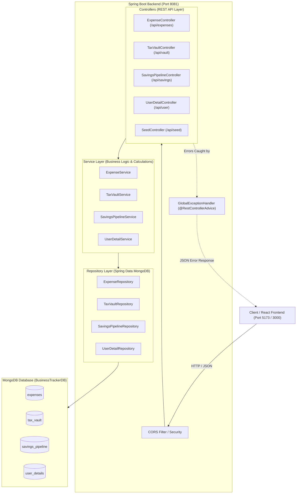

# Expense Tracker Web App — Backend Documentation

A robust, enterprise-ready Java Spring Boot REST API backed by MongoDB for personal and business expense tracking, automated GST tax liability isolation, savings pipeline management, and dashboard analytics.

---

## 1. System Architecture

The backend follows a clean **3-Tier Layered Architecture** with strict separation of concerns:



---

## 2. Technology Stack

- **Language:** Java 21 (LTS)
- **Framework:** Spring Boot 4.1.1
- **Database:** MongoDB (Local `127.0.0.1:27017` or MongoDB Atlas Cluster via `MONGODB_URI`)
- **Data Access:** Spring Data MongoDB (Sync Driver 5.8.1)
- **Validation:** Jakarta Validation (`hibernate-validator` 9.1.3)
- **JSON Serialization:** Jackson 3 (`tools.jackson`)
- **Testing:** JUnit 5, MockMvc, AssertJ
- **Build Tool:** Apache Maven 3.9.6 (via Maven Wrapper `mvnw.cmd`)
- **Default Server Port:** `8081` (configurable via `PORT` environment variable)

---

## 3. Directory Structure

```text
d:\Expense_Tracker\
├── .gitignore                                      # Standard Git ignore rules
├── SPRING_BOOT_FOR_NODEJS_DEVS.md                  # Conceptual guide for Node/Express developers
├── PROJECT_DOCUMENTATION.md                        # This comprehensive documentation file
└── backend\
    ├── .mvn\
    │   └── wrapper\
    │       └── maven-wrapper.properties            # Maven 3.9.6 wrapper distribution config
    ├── mvnw                                        # Unix shell wrapper
    ├── mvnw.cmd                                    # Windows PowerShell/CMD wrapper
    ├── pom.xml                                     # Maven project dependencies & build config
    └── src\
        ├── main\
        │   ├── java\
        │   │   └── com\businesstracker\backend\
        │   │       ├── BackendApplication.java     # Spring Boot application entry point
        │   │       │
        │   │       ├── BaseExpense.java            # Expense MongoDB document model
        │   │       ├── TaxableExpense.java         # Subclass for taxable expenses
        │   │       ├── TaxLiabilityVault.java      # Tax vault document model
        │   │       ├── SavingsPipelines.java       # Savings pipeline document model
        │   │       ├── Userdetail.java             # User financial profile document model
        │   │       │
        │   │       ├── ExpenseRepository.java      # MongoDB repository for expenses
        │   │       ├── TaxVaultRepository.java     # MongoDB repository for tax vault
        │   │       ├── SavingsPipelineRepository.java # MongoDB repository for savings pipelines
        │   │       ├── UserDetailRepository.java   # MongoDB repository for user details
        │   │       │
        │   │       ├── config\
        │   │       │   ├── CorsConfig.java         # Global CORS configuration (allows all origins)
        │   │       │   └── DataInitializer.java    # Auto-seeds realistic demo data on startup
        │   │       │
        │   │       ├── controller\
        │   │       │   ├── ExpenseController.java  # CRUD & summary endpoints for expenses
        │   │       │   ├── TaxVaultController.java # Tax isolation and vault endpoints
        │   │       │   ├── SavingsPipelineController.java # Savings borrow/return endpoints
        │   │       │   ├── UserDetailController.java      # User balance endpoints
        │   │       │   └── SeedController.java     # Reseed & reset database endpoints
        │   │       │
        │   │       ├── dto\
        │   │       │   ├── ApiResponse.java        # Standardized { success, message, data } wrapper
        │   │       │   ├── ExpenseSummaryDTO.java  # Aggregated analytics for dashboard charts
        │   │       │   ├── ReceiptProcessRequest.java  # DTO for OCR receipt parsing input
        │   │       │   ├── ReceiptProcessResponse.java # DTO for OCR receipt calculation output
        │   │       │   ├── BorrowRequest.java      # DTO for borrowing from savings
        │   │       │   └── BalanceUpdateRequest.java # DTO for updating user balance
        │   │       │
        │   │       ├── exception\
        │   │       │   ├── ResourceNotFoundException.java # 404 Not Found exception
        │   │       │   └── GlobalExceptionHandler.java    # Formats all errors as JSON
        │   │       │
        │   │       ├── service\
        │   │       │   ├── ExpenseService.java     # Expense calculations, filters, & queries
        │   │       │   ├── TaxVaultService.java    # Tax isolation engine & vault operations
        │   │       │   ├── SavingsPipelineService.java # Savings borrowing & return logic
        │   │       │   └── UserDetailService.java  # User balance management logic
        │   │       │
        │   │       └── TestMain.java               # Standalone console test for vault logic
        │   │
        │   └── resources\
        │       └── application.properties          # Server port & MongoDB connection strings
        │
        └── test\
            └── java\
                └── com\businesstracker\backend\
                    ├── BackendApplicationTests.java # Context loading test
                    └── ExpenseControllerTests.java  # Integration tests for all REST endpoints
```

---

## 4. MongoDB Collections & Schemas

### 1. `expenses` Collection ([`BaseExpense.java`](file:///d:/Expense_Tracker/backend/src/main/java/com/businesstracker/backend/BaseExpense.java))

| Field | Type | Description |
| :--- | :--- | :--- |
| `expenseId` | `String` (`@Id`) | Auto-generated MongoDB ObjectId (24-hex characters) |
| `title` | `String` | Short name/title of the expense (e.g., "Office Rent") |
| `baseAmount` | `double` | Amount before tax |
| `category` | `String` | Category (e.g., "Rent", "Utility", "Marketing", "Supplies") |
| `description` | `String` | Optional notes/details about the expense |
| `date` | `LocalDate` | Date of expense (defaults to today if not provided) |
| `paymentMethod` | `String` | Payment mode: "Cash", "Credit Card", "Bank Transfer", "Online" |
| `taxable` | `boolean` | Whether GST/tax applies to this expense |
| `taxPercentage` | `double` | Tax rate in decimal (e.g. `0.18` for 18%) |
| `taxAmount` | `double` | Calculated isolated tax amount (`baseAmount * taxPercentage`) |
| `totalAmount` | `double` | Total cost (`baseAmount + taxAmount`) |
| `createdAt` | `LocalDateTime` | Record creation timestamp |

---

### 2. `tax_vault` Collection ([`TaxLiabilityVault.java`](file:///d:/Expense_Tracker/backend/src/main/java/com/businesstracker/backend/TaxLiabilityVault.java))

| Field | Type | Description |
| :--- | :--- | :--- |
| `id` | `String` (`@Id`) | Unique ID (Default: `"DEFAULT_VAULT"`) |
| `totalTaxOwed` | `double` | Cumulative isolated tax obligations set aside |
| `businessUsableCash`| `double` | Safe usable operational cash balance |
| `isEmergencyFundLocked` | `boolean` | Lock state to prevent spending emergency reserves |
| `lastUpdated` | `LocalDateTime` | Timestamp of last vault activity |

---

### 3. `savings_pipeline` Collection ([`SavingsPipelines.java`](file:///d:/Expense_Tracker/backend/src/main/java/com/businesstracker/backend/SavingsPipelines.java))

| Field | Type | Description |
| :--- | :--- | :--- |
| `transactionId` | `String` (`@Id`) | Human-readable transaction identifier (e.g. `"TXN-SRV-901"`) |
| `purpose` | `String` | Reason for borrowing from savings |
| `borrowedAmount`| `double` | Amount borrowed |
| `dateBorrowed` | `LocalDate` | Date the money was borrowed |
| `dateReturned` | `LocalDate` | Date the money was returned to savings (null if outstanding) |
| `isReturned` | `boolean` | `true` if returned, `false` if outstanding debt |
| `createdAt` | `LocalDateTime` | Record timestamp |

---

### 4. `user_details` Collection ([`Userdetail.java`](file:///d:/Expense_Tracker/backend/src/main/java/com/businesstracker/backend/Userdetail.java))

| Field | Type | Description |
| :--- | :--- | :--- |
| `userId` | `String` (`@Id`) | Unique user identifier (Default: `"DEFAULT_USER"`) |
| `username` | `String` | Account display name |
| `email` | `String` | Account email address |
| `businessBalance` | `double` | Current liquid business operating funds |
| `savingsBalance` | `double` | Current long-term emergency/savings reserve |
| `currency` | `String` | Currency symbol/code (e.g., `"PKR"`, `"USD"`) |
| `updatedAt` | `LocalDateTime` | Last balance modification timestamp |

---

## 5. Complete REST API Reference

Base URL: `http://localhost:8081`

All responses follow the unified envelope:
```json
{
  "success": true,
  "message": "Human-readable status message",
  "data": { ... },
  "timestamp": "2026-10-27T00:29:13.453"
}
```

---

### 1. Expenses API (`/api/expenses`)

#### `GET /api/expenses`
Retrieves a filtered, sorted list of expenses.
* **Query Parameters:**
  * `category` *(optional)*: Filter by exact category (case-insensitive). Example: `Rent`
  * `search` *(optional)*: Case-insensitive search matching title or description. Example: `server`
  * `startDate` *(optional)*: Filter by start date (`YYYY-MM-DD`). Example: `2026-10-01`
  * `endDate` *(optional)*: Filter by end date (`YYYY-MM-DD`). Example: `2026-10-31`
* **Response (200 OK):**
```json
{
  "success": true,
  "message": "Expenses retrieved successfully",
  "data": [
    {
      "expenseId": "6adfa970acc16d99ad26659f",
      "title": "Cloud Server Hosting",
      "baseAmount": 8500.0,
      "category": "Utility",
      "description": "AWS EC2 production instance",
      "date": "2026-10-27",
      "paymentMethod": "Credit Card",
      "taxable": true,
      "taxPercentage": 0.18,
      "taxAmount": 1530.0,
      "totalAmount": 10030.0,
      "createdAt": "2026-10-27T00:26:40.134"
    }
  ]
}
```

#### `GET /api/expenses/{id}`
Retrieves a single expense by ID.
* **Response (200 OK):** Returns single expense object in `data`.
* **Response (404 Not Found):** If ID does not exist.

#### `POST /api/expenses`
Creates a new expense.
* **Request Body:**
```json
{
  "title": "Commercial Office Rent",
  "baseAmount": 45000.0,
  "category": "Rent",
  "description": "Monthly commercial lease",
  "date": "2026-10-25",
  "paymentMethod": "Bank Transfer",
  "taxable": false,
  "taxPercentage": 0.0
}
```
* **Response (201 Created):** Returns created expense with generated `expenseId` and calculated totals.

#### `PUT /api/expenses/{id}`
Updates an existing expense.
* **Request Body:** Updated fields (same structure as POST).
* **Response (200 OK):** Returns updated expense.

#### `DELETE /api/expenses/{id}`
Deletes an expense.
* **Response (200 OK):** `{ "success": true, "message": "Expense deleted successfully", "data": null }`

#### `GET /api/expenses/summary`
Generates aggregated metrics for charts and cards on your frontend dashboard.
* **Response (200 OK):**
```json
{
  "success": true,
  "message": "Expense summary generated",
  "data": {
    "totalExpenses": 147104.0,
    "totalBaseAmount": 135800.0,
    "totalTaxAmount": 11304.0,
    "transactionCount": 10,
    "categoryBreakdown": {
      "Rent": 45000.0,
      "Utility": 33640.0,
      "Marketing": 29500.0,
      "Food & Entertainment": 8200.0,
      "Travel": 7800.0,
      "Supplies": 5664.0,
      "Maintenance": 5500.0
    },
    "monthlyBreakdown": {
      "2026-10": 147104.0
    },
    "recentExpenses": [ ... ]
  }
}
```

#### `GET /api/expenses/categories`
Returns a distinct list of all expense categories.
* **Response (200 OK):**
```json
{
  "success": true,
  "message": "Categories retrieved",
  "data": [
    "Food & Entertainment",
    "Maintenance",
    "Marketing",
    "Rent",
    "Salaries",
    "Supplies",
    "Travel",
    "Utility"
  ]
}
```

---

### 2. Tax Liability Vault API (`/api/vault`)

#### `GET /api/vault`
Retrieves current tax liabilities and usable cash.
* **Response (200 OK):**
```json
{
  "success": true,
  "message": "Vault state retrieved",
  "data": {
    "id": "DEFAULT_VAULT",
    "totalTaxOwed": 6300.0,
    "businessUsableCash": 65000.0,
    "emergencyFundLocked": false,
    "lastUpdated": "2026-10-27T00:26:40.718"
  }
}
```

#### `POST /api/vault/process-receipt`
Simulates the **OCR Tax Isolating Engine**. When an employee uploads an invoice/receipt, this endpoint isolates the GST portion, deducts the base cost from usable cash, adds the tax portion to the tax vault, and records the expense in MongoDB.
* **Request Body:**
```json
{
  "title": "Vendor Software License",
  "receiptAmount": 11800.0,
  "gstPercentage": 0.18,
  "category": "Software",
  "description": "JetBrains Team Pack Subscription",
  "paymentMethod": "Credit Card"
}
```
* **Response (200 OK):**
```json
{
  "success": true,
  "message": "Receipt processed and tax isolated successfully",
  "data": {
    "receiptAmount": 11800.0,
    "baseExpense": 10000.0,
    "isolatedTax": 1800.0,
    "gstPercentage": 0.18,
    "remainingUsableCash": 55000.0,
    "currentTotalTaxOwed": 8100.0,
    "emergencyFundLocked": false,
    "createdExpense": { ... }
  }
}
```

#### `PUT /api/vault/emergency-lock?lock=true|false`
Locks or unlocks the emergency fund reserve to prevent overspending.

#### `PUT /api/vault/cash?amount=75000`
Updates the business usable cash reserve amount.

---

### 3. Savings Pipeline API (`/api/savings`)

#### `GET /api/savings`
Lists all borrow/return transactions from the savings fund.
* **Query Parameters:** `isReturned` *(optional)*: `true` or `false`

#### `POST /api/savings/borrow`
Records an internal loan from the savings fund into operating cash. Automatically transfers funds from `savingsBalance` into `businessBalance`.
* **Request Body:**
```json
{
  "amount": 5000.0,
  "purpose": "Office Coffee Machine Repair"
}
```
* **Response (201 Created):** Returns created pipeline record with transaction ID (e.g., `TXN-0D504A7B`).

#### `PUT /api/savings/{id}/return`
Marks a borrowed debt as fully returned. Automatically replenishes `savingsBalance` from `businessBalance`.

---

### 4. User Financial Overview API (`/api/user`)

#### `GET /api/user`
Retrieves user financial balances and currency.
* **Response (200 OK):**
```json
{
  "success": true,
  "message": "User details retrieved",
  "data": {
    "userId": "DEFAULT_USER",
    "username": "Business Manager",
    "email": "finance@mybusiness.com",
    "businessBalance": 220000.0,
    "savingsBalance": 110000.0,
    "currency": "PKR",
    "updatedAt": "2026-10-27T00:26:40.676"
  }
}
```

#### `PUT /api/user/balance`
Updates operating and savings balances.
* **Request Body:**
```json
{
  "businessBalance": 250000.0,
  "savingsBalance": 125000.0
}
```

---

### 5. Demo Data Seed API (`/api/seed`)

* `POST /api/seed`: Re-populates realistic demo expenses, user balances, and tax vault.
* `DELETE /api/seed`: Clears all MongoDB collections and resets to clean initial demo state.

---

## 6. How to Run the Code

### 1. Prerequisites
- **Java 21 LTS** installed (`C:\Program Files\Java\jdk-21`).
- **MongoDB** running locally on port `27017` (or MongoDB Atlas connection string).

### 2. Start the Application
Open PowerShell and navigate into the `backend` folder:
```powershell
cd d:\Expense_Tracker\backend
$env:JAVA_HOME = "C:\Program Files\Java\jdk-21"
.\mvnw.cmd spring-boot:run
```

Once started, the backend will be available at:
**`http://localhost:8081`**

### 3. Run the Test Suite
```powershell
cd d:\Expense_Tracker\backend
$env:JAVA_HOME = "C:\Program Files\Java\jdk-21"
.\mvnw.cmd test
```

### 4. Switch to MongoDB Atlas (Cloud)
To connect to MongoDB Atlas instead of local MongoDB, set the `MONGODB_URI` environment variable before running:
```powershell
$env:MONGODB_URI = "mongodb+srv://<username>:<password>@cluster0.lxhoiab.mongodb.net/BusinessTrackerDB?retryWrites=true&w=majority"
.\mvnw.cmd spring-boot:run
```

---

## 7. Frontend (React.js) Integration Examples

### 1. API Helper (`src/services/api.js`)
```javascript
const API_BASE = 'http://localhost:8081/api';

export async function fetchApi(endpoint, options = {}) {
  const response = await fetch(`${API_BASE}${endpoint}`, {
    headers: {
      'Content-Type': 'application/json',
      ...options.headers,
    },
    ...options,
  });

  const resJson = await response.json();
  if (!response.ok || !resJson.success) {
    throw new Error(resJson.message || 'API request failed');
  }
  return resJson.data;
}
```

### 2. Dashboard Component Example
```jsx
import React, { useEffect, useState } from 'react';
import { fetchApi } from '../services/api';

export default function Dashboard() {
  const [summary, setSummary] = useState(null);
  const [user, setUser] = useState(null);
  const [vault, setVault] = useState(null);

  useEffect(() => {
    Promise.all([
      fetchApi('/expenses/summary'),
      fetchApi('/user'),
      fetchApi('/vault'),
    ]).then(([summaryData, userData, vaultData]) => {
      setSummary(summaryData);
      setUser(userData);
      setVault(vaultData);
    });
  }, []);

  if (!summary || !user || !vault) return <div>Loading dashboard metrics...</div>;

  return (
    <div className="dashboard-grid">
      <div className="card">
        <h3>Business Balance</h3>
        <p className="amount">{user.currency} {user.businessBalance.toLocaleString()}</p>
      </div>

      <div className="card">
        <h3>Total Spent</h3>
        <p className="amount">{user.currency} {summary.totalExpenses.toLocaleString()}</p>
      </div>

      <div className="card">
        <h3>Isolated Tax Owed</h3>
        <p className="amount tax">{user.currency} {vault.totalTaxOwed.toLocaleString()}</p>
      </div>

      <div className="card">
        <h3>Usable Operational Cash</h3>
        <p className="amount success">{user.currency} {vault.businessUsableCash.toLocaleString()}</p>
      </div>
    </div>
  );
}
```
